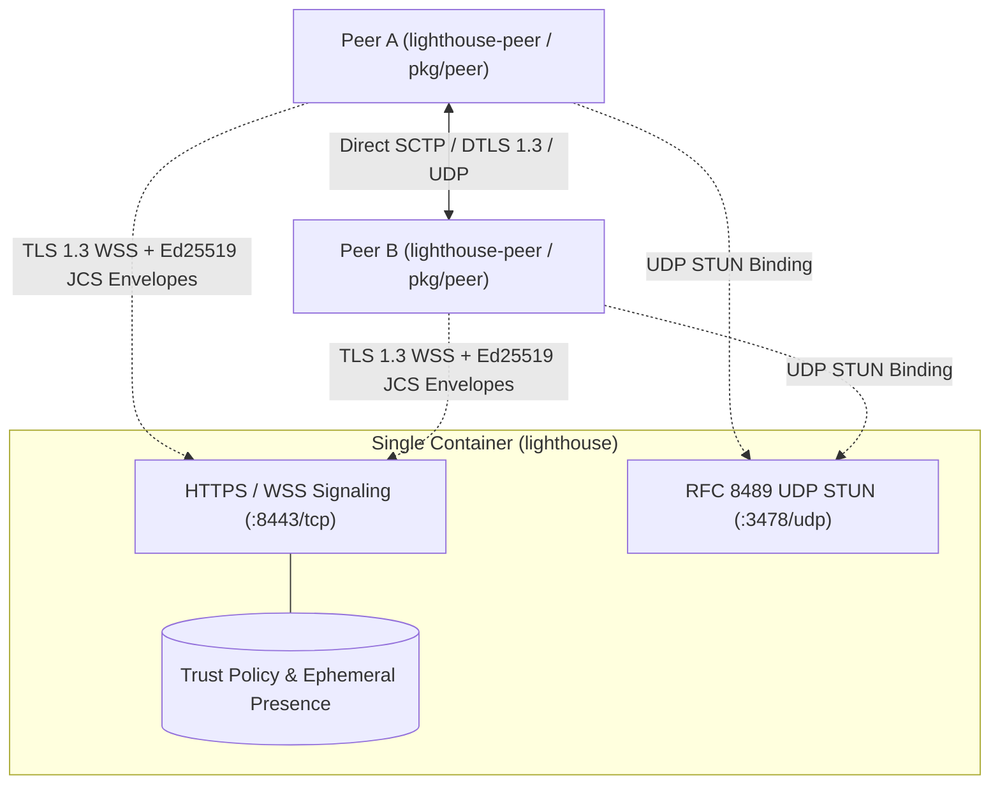

# Lighthouse — Direct P2P WebRTC Networking

Lighthouse coordinates authenticated, end-to-end encrypted, direct peer-to-peer WebRTC DataChannel connections through a single-container control-plane hub. Application payloads travel exclusively between participating peers over SCTP protected by DTLS 1.3 above ICE-negotiated UDP paths.

## Architecture



### Design Guarantees

- **Control-Plane Separation**: `cmd/lighthouse` implements peer challenge-response registration, presence leases, authorized lookup, signed signaling forwarding, and UDP STUN Binding. It contains no WebRTC `PeerConnection`, TURN relay, or payload forwarding path.
- **Independent Peer Authentication**: Peers authenticate each other using persistent Ed25519 identities verified against local pinned keys or offline-authority-signed membership records, independent of hub assertions.
- **DTLS 1.3 Only**: Peer transport enforces DTLS 1.3 (`0xFEFC`) with ephemeral ECDHE forward secrecy, AEAD record protection, replay window enforcement, and Ed25519-authenticated SHA-256 certificate fingerprints.
- **Direct-Only Fail-Closed ICE**: Only UDP `host`, `srflx`, and `prflx` candidates are permitted. `relay` candidates, TURN servers, TCP candidates, and hub service endpoints are rejected before installation and on selected-pair transitions.

## Components

| Component | Path | Purpose |
| --- | --- | --- |
| `lighthouse` | `cmd/lighthouse` | HTTPS/WSS signaling hub (`:8443/tcp`) and UDP STUN responder (`:3478/udp`) |
| `lighthouse-peer` | `cmd/lighthouse-peer` | Native CLI client for authenticated direct DataChannel sessions |
| `lighthouse-admin` | `cmd/lighthouse-admin` | Offline key generation, membership signing, and SQLite policy management |
| `pkg/identity` | `pkg/identity` | Ed25519 keys, `peer_id` derivation, offline authority certificates, ACLs |
| `pkg/protocol` | `pkg/protocol` | Strict JSON/RFC 8785 JCS control-plane schema and signed envelopes |
| `pkg/peer` | `pkg/peer` | Go SDK for direct-only WebRTC sessions, backpressure, and ICE restarts |

## Quick Start

### 1. Build Binaries

```bash
CGO_ENABLED=0 go build -o bin/lighthouse ./cmd/lighthouse
CGO_ENABLED=0 go build -o bin/lighthouse-peer ./cmd/lighthouse-peer
CGO_ENABLED=0 go build -o bin/lighthouse-admin ./cmd/lighthouse-admin
```

### 2. Provision Offline Authority, Peer Keys, and Policy

Generate an offline authority key and two peer keys:

```bash
./bin/lighthouse-admin keygen -out config/authority.key
./bin/lighthouse-admin keygen -out peer-a.key
./bin/lighthouse-admin keygen -out peer-b.key
```

Issue offline-authority-signed membership records for each peer:

```bash
./bin/lighthouse-admin issue-membership \
  -authority config/authority.key \
  -peer-pub <PEER_A_PUBLIC_KEY> \
  -allow <PEER_B_ID> \
  -ttl 720h \
  -out peer-a-membership.json

./bin/lighthouse-admin issue-membership \
  -authority config/authority.key \
  -peer-pub <PEER_B_PUBLIC_KEY> \
  -allow <PEER_A_ID> \
  -ttl 720h \
  -out peer-b-membership.json
```

Create `config/policy.json` (provisioned to the hub and each peer):

```json
{
  "v": 1,
  "trusted_authorities": [
    "<AUTHORITY_PUBLIC_KEY>"
  ],
  "acl_rules": [
    {
      "peer_a": "<PEER_A_ID>",
      "peer_b": "<PEER_B_ID>"
    }
  ]
}
```

### 3. Deploy the Hub with Docker Compose

Place `tls.crt`, `tls.key`, and `policy.json` in `./config`, then build and run the single container:

```bash
docker compose up -d --build
```

Reload updated ACL or revocation policies without restarting the process by sending `SIGHUP` to `lighthouse`.

### 4. Connect Two Peers

Start the responder peer:

```bash
./bin/lighthouse-peer \
  -key peer-b.key \
  -membership peer-b-membership.json \
  -policy config/policy.json \
  -hub wss://hub.example.com/v1/signal \
  -stun stun:hub.example.com:3478
```

Dial from the initiator peer:

```bash
./bin/lighthouse-peer \
  -key peer-a.key \
  -membership peer-a-membership.json \
  -policy config/policy.json \
  -hub wss://hub.example.com/v1/signal \
  -stun stun:hub.example.com:3478 \
  -connect <PEER_B_ID>
```

## Hub Configuration

`lighthouse` accepts flags or environment variables:

| Flag | Environment Variable | Default | Description |
| --- | --- | --- | --- |
| `-https-addr` | `LIGHTHOUSE_HTTPS_ADDR` | `:8443` | TCP listen address for HTTPS `/healthz` and WSS `/v1/signal` |
| `-stun-addr` | `LIGHTHOUSE_STUN_ADDR` | `:3478` | UDP listen address for RFC 8489 STUN Binding |
| `-hub-origin` | `LIGHTHOUSE_HUB_ORIGIN` | `wss://localhost:8443` | Canonical WSS origin bound into registration challenge proofs |
| `-tls-cert` | `LIGHTHOUSE_TLS_CERT` | `/etc/lighthouse/tls.crt` | Server TLS certificate PEM |
| `-tls-key` | `LIGHTHOUSE_TLS_KEY` | `/etc/lighthouse/tls.key` | Server TLS private key PEM |
| `-policy` | `LIGHTHOUSE_POLICY` | `/etc/lighthouse/policy.json` | Trust, membership, ACL, and revocation policy file |
| `-sqlite` | `LIGHTHOUSE_SQLITE` | *(disabled)* | Optional SQLite database path for persistent administrative policy |
| `-presence-heartbeat` | — | `20s` | Advertised peer presence heartbeat interval |
| `-presence-ttl` | — | `60s` | Ephemeral presence lease expiration |

## Further Documentation

- [Protocol, Wire Formats, and Architecture](docs/protocol-and-architecture.md)
- [Verification Procedures and Invariants](docs/verification.md)
