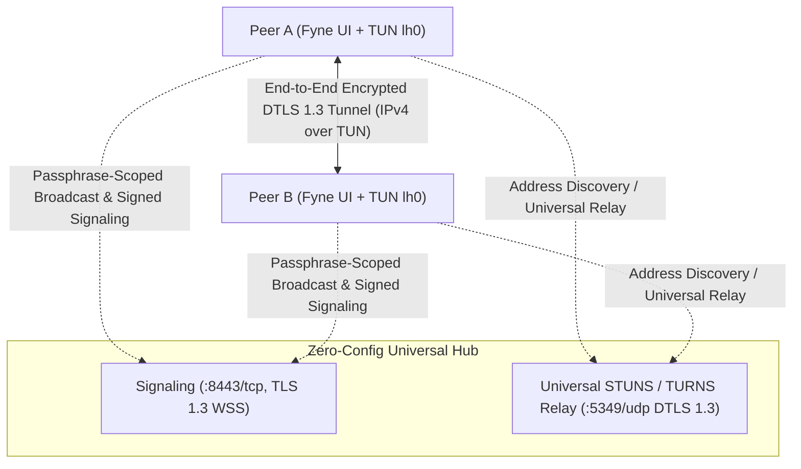

# Lighthouse

Lighthouse binds a local OS virtual network interface (`lh0`) through a Fyne desktop app (`lighthouse-ui`) and connects peers over end-to-end encrypted WebRTC tunnels via one zero-config universal hub and relay (`lighthouse hub`).

There are no hub configuration files or ACLs. Every incoming connection is gated strictly by an explicit user **Allow**, **Deny**, or **Blacklist** action.

## How It Works



1. **Zero-Config Universal Hub & Relay**: `lighthouse hub` runs without static ACL files or databases. It serves TLS 1.3 WSS signaling, an integrated DTLS 1.3 / UDP STUNS + TURNS relay, assigns each peer a deterministic virtual IPv4 address from the hub's configured `--cidr` (`LIGHTHOUSE_CIDR`, default `10.88.0.0/16`), and enforces automatic server-side ACL based on passphrase channel membership and active broadcast status. Operators running a private hub may optionally set `--passphrase` (`LIGHTHOUSE_PASSPHRASE`) to restrict hub registration via an offline shared passphrase.
2. **Passphrase-Scoped Broadcasting & Auto-ACL**: Broadcasting is off by default. When a peer enables broadcast under an offline shared passphrase, only peers joined to that exact passphrase discover it and are automatically permitted by the hub to initiate connection offers to it. Turning broadcast off immediately blocks new incoming connection attempts at the hub. The raw passphrase is never sent over the network.
3. **Explicit User Consent & Blacklist**: Every peer holds a local cryptographic identity (`ed25519`, `ed448`, `nistp-256`, `nistp-384`, `nistp-521`, or `rsa`) assigned an IP from the hub's CIDR upon registration. Incoming connection requests display the verified peer ID, key algorithm, virtual IP, and DTLS fingerprint and require explicit **Allow**, **Deny**, or **Blacklist** action. Blacklisted peers are dropped immediately and blocked from future offers.
4. **Bound Virtual Network Interface**: Allowing a peer installs a route on the local TUN interface (`lh0`) backed by an end-to-end DTLS 1.3 WebRTC tunnel with source-IP anti-spoofing. UDP is prioritized by default; pass `--tcp-only` to disable UDP completely and operate over TLS 1.3 / TCP and ICE-TCP, or `--insecure` to allow plaintext `stun:`/`turn:`.

## Usage

### 1. Build or Pull

Build both binaries locally:

```bash
make build      # static linux/amd64 hub -> bin/lighthouse
make build-ui   # Fyne desktop TUN app -> bin/lighthouse-ui
```

Or run the universal hub container (`linux/amd64`):

```bash
docker pull ghcr.io/<owner>/<repo>:latest
docker compose up -d --build
```

All `LIGHTHOUSE_*` environment variables and optional local `.env` entries are read at runtime.

### 2. Run the Universal Hub

Start with zero configuration (ephemeral self-signed TLS + universal DTLS 1.3 / UDP relay):

```bash
./bin/lighthouse hub
```

Run with a TLS certificate and an optional offline hub passphrase:

```bash
./bin/lighthouse hub \
  --tls-cert tls.crt \
  --tls-key tls.key \
  --hub-origin wss://hub.example.com \
  --turn-public-ip 203.0.113.10 \
  --passphrase "<OFFLINE_SHARED_PASSPHRASE>"
```

| Flag | Environment Variable | Default | Description |
| --- | --- | --- | --- |
| `--https-addr` | `LIGHTHOUSE_HTTPS_ADDR` | `:8443` | TCP listen address for HTTPS/WSS signaling |
| `--stuns-addr` | `LIGHTHOUSE_STUNS_ADDR` | `:5349` | Encrypted STUNS/TURNS address (UDP default; TCP with `--tcp-only`) |
| `--cidr` | `LIGHTHOUSE_CIDR` | `10.88.0.0/16` | Virtual IPv4 subnet CIDR assigned to connected peers |
| `-P, --passphrase` | `LIGHTHOUSE_PASSPHRASE` | *(open)* | Optional offline shared passphrase gating hub registration |
| `--no-relay` | `LIGHTHOUSE_NO_RELAY` | `false` | Disable integrated universal TURNS relay |
| `--turn-public-ip` | `LIGHTHOUSE_TURN_PUBLIC_IP` | *(auto)* | Public IP advertised in TURN relay allocations |
| `--turn-advertise-host` | `LIGHTHOUSE_TURN_ADVERTISE_HOST` | *(auto)* | Host advertised to peers in universal relay URIs |
| `--turn-secret` | `LIGHTHOUSE_TURN_SECRET` | *(ephemeral)* | Optional HMAC secret for universal relay credentials |
| `--turn-realm` | `LIGHTHOUSE_TURN_REALM` | `lighthouse` | TURN authentication realm |
| `--turn-tls-addr` | `LIGHTHOUSE_TURN_TLS_ADDR` | *(disabled)* | Optional TLS 1.3 / TCP TURNS fallback address |
| `--hub-origin` | `LIGHTHOUSE_HUB_ORIGIN` | `wss://localhost:8443` | Canonical WSS origin verified during registration |
| `--tls-cert` | `LIGHTHOUSE_TLS_CERT` | *(ephemeral)* | TLS/DTLS certificate PEM path |
| `--tls-key` | `LIGHTHOUSE_TLS_KEY` | *(ephemeral)* | TLS/DTLS private key PEM path |
| `--tcp-only` | `LIGHTHOUSE_TCP_ONLY` | `false` | Disable UDP; serve STUNS over TLS 1.3 / TCP only |
| `--insecure` | `LIGHTHOUSE_INSECURE` | `false` | Opt in to plaintext `stun:`/`turn:` listener on `--stun-addr` |
| `--stun-addr` | `LIGHTHOUSE_STUN_ADDR` | *(disabled)* | Plaintext STUN/TURN address (requires `--insecure`, default `:3478`) |

### 3. Run the Desktop Interface App

Launch `lighthouse-ui` (requires `CAP_NET_ADMIN` / TUN privileges to bind `lh0` on Linux):

```bash
./bin/lighthouse-ui --hub wss://hub.example.com/v1/signal --ifname lh0
```

Inside the app:

1. Click **Bind & Connect** to register with the hub, receive an assigned IP from the hub's CIDR (default `10.88.0.0/16`), and bind the local virtual network interface (`lh0`).
2. Enter a shared passphrase and click **Join** to listen for peers on that passphrase. Toggle **Broadcast** only when you want peers with the same passphrase to discover you.
3. Click **Connect** next to a discovered peer (or enter a Peer ID directly).
4. On the receiving peer, review the incoming connection prompt and click **Allow**, **Deny**, or **Blacklist**. Manage active tunnels and blacklisted peers from their respective tabs.

| Flag | Environment Variable | Default | Description |
| --- | --- | --- | --- |
| `--hub` | `LIGHTHOUSE_HUB_URL` | `wss://localhost:8443/v1/signal` | Universal hub WSS signaling URL |
| `--hub-passphrase` | `LIGHTHOUSE_PASSPHRASE` | *(none)* | Optional offline hub registration passphrase |
| `--ifname` | `LIGHTHOUSE_IFNAME` | `lh0` | OS TUN virtual network interface name |
| `--ca` | `LIGHTHOUSE_CA` | *(system)* | Optional PEM Root CA bundle |
| `-s, --stun` | `LIGHTHOUSE_STUN_URI` | *(auto)* | Optional explicit STUNS/TURNS URI |
| `-k, --key` | — | `~/.config/lighthouse/identity.key` | Local identity key path (generated if absent) |
| `-a, --algo` | — | `ed25519` | Identity key algorithm (`ed25519`, `ed448`, `nistp-256`, `nistp-384`, `nistp-521`, `rsa`) |
| `--blacklist` | — | `~/.config/lighthouse/blacklist.json` | Local peer blacklist file path |
| `--tcp-only` | `LIGHTHOUSE_TCP_ONLY` | `false` | Disable UDP; use ICE-TCP and TLS 1.3 / TCP only |
| `--insecure` | `LIGHTHOUSE_INSECURE` | `false` | Allow plaintext `stun:`/`turn:` URIs |

## Documentation

- [Protocol, Wire Formats, and Architecture](docs/protocol-and-architecture.md)
- [Verification Procedures and Invariants](docs/verification.md)
