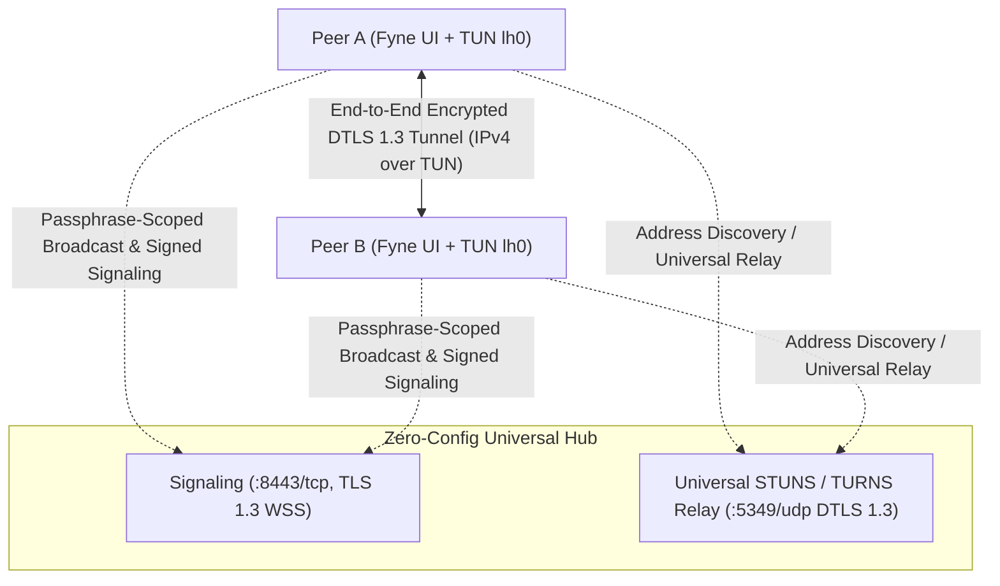

<p align="center">
  
</p>

<h1 align="center">Lighthouse</h1>

Lighthouse binds a local OS virtual network interface (`lh0`) through a Fyne desktop app (`lighthouse-ui`) and connects peers over end-to-end encrypted WebRTC tunnels via one zero-config universal hub and relay (`lighthouse hub`).

There are no hub configuration files or ACLs. Every incoming connection is gated strictly by an explicit user **Allow**, **Deny**, or **Blacklist** action.

## How It Works



1. **Blinded Zero-Config Universal Hub & Relay**: `lighthouse hub` runs as an open blinded relay with no hub passphrase, static ACL files, or databases. It serves TLS 1.3 WSS signaling, an integrated DTLS 1.3 / UDP STUNS + TURNS relay, generates and persists its own TLS 1.3 certificate and key on initial container startup using `--tls-algo` (`LIGHTHOUSE_TLS_ALGO`, default `ed25519`), assigns each peer a deterministic virtual IPv4 address from `--cidr` (`LIGHTHOUSE_CIDR`, default `10.88.0.0/16`), enforces automatic room-scoped ACL, and prunes empty rooms when peers leave or expire.
2. **Passphrase-Scoped Rooms & Auto-ACL**: Any client-side passphrase dynamically forms an isolated blinded room. Broadcasting is off by default. When a peer enables broadcast in a room, only peers joined to that exact passphrase discover it and are automatically permitted by the hub to initiate connection offers to it. Turning broadcast off immediately blocks new incoming connection attempts, and empty rooms with zero active peers are automatically removed. The raw passphrase is never sent over the network.
3. **Explicit User Consent & Blacklist**: Every peer holds a local cryptographic identity (`ed25519`, `ed448`, `nistp-256`, `nistp-384`, `nistp-521`, or `rsa`) assigned an IP from the hub's CIDR upon registration. Incoming connection requests display the verified peer ID, key algorithm, virtual IP, and DTLS fingerprint and require explicit **Allow**, **Deny**, or **Blacklist** action. Blacklisted peers are dropped immediately and blocked from future offers.
4. **Bound Virtual Network Interface**: Allowing a peer installs a route on the local TUN interface (`lh0`) backed by an end-to-end DTLS 1.3 WebRTC tunnel with source-IP anti-spoofing. UDP is prioritized by default; pass `--tcp-only` to disable UDP completely and operate over TLS 1.3 / TCP and ICE-TCP, or `--insecure` to allow plaintext `stun:`/`turn:`.

## Usage

### 1. Build or Pull

Build both binaries locally:

```bash
make build      # static linux/amd64 hub -> bin/lighthouse
make build-ui   # Fyne desktop TUN app -> bin/lighthouse-ui
make hooks      # install lefthook pre-commit and pre-push checks
```

Or run the universal hub container (`linux/amd64`):

```bash
docker pull ghcr.io/<owner>/<repo>:latest
docker compose up -d --build
```

For PaaS / reverse-proxy hosts such as Cloudtype (HTTP/HTTPS TLS termination on port `443`, no UDP): expose port `8443` (or set `PORT`) as an **HTTP** service, leave `LIGHTHOUSE_DOMAIN` unset to accept rotating hosts, optionally set `LIGHTHOUSE_NO_RELAY=true` when UDP `5349` is unavailable, and connect clients using the bare HTTPS hostname (e.g. `port-0-<app>-<id>.sel3.cloudtype.app`).

All `LIGHTHOUSE_*` environment variables and optional local `.env` entries are read at runtime.

### 2. Run the Universal Hub

Start with zero configuration (auto-generated Ed25519 TLS 1.3 cert + universal DTLS 1.3 / UDP relay):

```bash
./bin/lighthouse hub
```

Run with a single domain (`LIGHTHOUSE_DOMAIN` in `.env` or `--domain`) to auto-configure `wss://<domain>`, TURN advertise host, TURN realm, TLS SAN, and `lighthouse-ui`'s `wss://<domain>/v1/signal`. On initial `docker run` or `docker compose up`, the hub generates `/etc/lighthouse/tls.crt` and `/etc/lighthouse/tls.key` using `LIGHTHOUSE_TLS_ALGO` and reuses them across restarts:

```bash
./bin/lighthouse hub \
  --domain hub.example.com \
  --tls-algo ed25519 \
  --turn-public-ip 203.0.113.10
```

| Flag | Environment Variable | Default | Description |
| --- | --- | --- | --- |
| `--domain` | `LIGHTHOUSE_DOMAIN` | *(accept all)* | Optional hub domain pinning `--hub-origin` (`wss://<domain>`), `--turn-advertise-host`, `--turn-realm`, and TLS SAN; omit to accept rotating domains/ports (e.g. Cloudtype) |
| `--https-addr` | `LIGHTHOUSE_HTTPS_ADDR` | `:${PORT}` / `:8443` | TCP listen address for HTTPS/WSS signaling (honors `PORT`) |
| `--stuns-addr` | `LIGHTHOUSE_STUNS_ADDR` | `:5349` | Encrypted STUNS/TURNS address (UDP default; TCP with `--tcp-only`) |
| `--cidr` | `LIGHTHOUSE_CIDR` | `10.88.0.0/16` | Virtual IPv4 subnet CIDR assigned to connected peers |
| `--tls-algo` | `LIGHTHOUSE_TLS_ALGO` | `ed25519` | TLS/DTLS key algorithm generated on initial run (`ed25519`, `nistp-256`, `nistp-384`, `nistp-521`, `rsa`) |
| `--tls-rsa-bits` | `LIGHTHOUSE_TLS_RSA_BITS` | `3072` | RSA modulus bit length when `--tls-algo=rsa` (`2048`–`8192`) |
| `--no-relay` | `LIGHTHOUSE_NO_RELAY` | `false` | Disable integrated universal TURNS relay |
| `--turn-public-ip` | `LIGHTHOUSE_TURN_PUBLIC_IP` | *(auto)* | Public IP advertised in TURN relay allocations |
| `--turn-advertise-host` | `LIGHTHOUSE_TURN_ADVERTISE_HOST` | *(from domain)* | Host (or `host:port`) advertised to peers in universal relay URIs |
| `--turn-secret` | `LIGHTHOUSE_TURN_SECRET` | *(ephemeral)* | Optional HMAC secret for universal relay credentials |
| `--turn-realm` | `LIGHTHOUSE_TURN_REALM` | *(from domain / `lighthouse`)* | TURN authentication realm |
| `--turn-tls-addr` | `LIGHTHOUSE_TURN_TLS_ADDR` | *(disabled)* | Optional TLS 1.3 / TCP TURNS fallback address |
| `--hub-origin` | `LIGHTHOUSE_HUB_ORIGIN` | *(accept all / from domain)* | Optional pinned canonical WSS origin verified during registration |
| `--tcp-only` | `LIGHTHOUSE_TCP_ONLY` | `false` | Disable UDP; serve STUNS over TLS 1.3 / TCP only |
| `--insecure` | `LIGHTHOUSE_INSECURE` | `false` | Opt in to plaintext `stun:`/`turn:` listener on `--stun-addr` |
| `--stun-addr` | `LIGHTHOUSE_STUN_ADDR` | *(disabled)* | Plaintext STUN/TURN address (requires `--insecure`, default `:3478`) |

### 3. Run the Desktop Interface App

Launch `lighthouse-ui` (requires `CAP_NET_ADMIN` / TUN privileges to bind `lh0` on Linux):

```bash
./bin/lighthouse-ui --hub hub.example.com --ifname lh0
```

Inside the app:

1. Enter your hub domain (e.g. `hub.example.com` — omit `wss://` and `/v1/signal`) and click **Bind & Connect** to register, receive an assigned IP from the hub's CIDR (default `10.88.0.0/16`), and bind the local virtual network interface (`lh0`).
2. Enter a shared passphrase and click **Join** to listen for peers on that passphrase. Toggle **Broadcast** only when you want peers with the same passphrase to discover you.
3. Click **Connect** next to a discovered peer (or enter a Peer ID directly).
4. On the receiving peer, review the incoming connection prompt and click **Allow**, **Deny**, or **Blacklist**. Manage active tunnels and blacklisted peers from their respective tabs.

| Flag | Environment Variable | Default | Description |
| --- | --- | --- | --- |
| `--domain` | `LIGHTHOUSE_DOMAIN` | *(none)* | Single hub domain (e.g. `hub.example.com`) |
| `--hub` | `LIGHTHOUSE_HUB_URL` | *(from domain / `localhost:8443`)* | Hub domain or WSS URL (`wss://` and `/v1/signal` optional) |
| `--ifname` | `LIGHTHOUSE_IFNAME` | `lh0` | OS TUN virtual network interface name |
| `--ca` | `LIGHTHOUSE_CA` | *(system)* | Optional PEM Root CA bundle |
| `-s, --stun` | `LIGHTHOUSE_STUN_URI` | *(auto)* | Optional explicit STUNS/TURNS URI |
| `-k, --key` | — | `~/.config/lighthouse/identity.key` | Local identity key path (generated if absent) |
| `-a, --algo` | — | `ed25519` | Identity key algorithm (`ed25519`, `ed448`, `nistp-256`, `nistp-384`, `nistp-521`, `rsa`) |
| `--blacklist` | — | `~/.config/lighthouse/blacklist.json` | Local peer blacklist file path |
| `--tcp-only` | `LIGHTHOUSE_TCP_ONLY` | `false` | Disable UDP; use ICE-TCP and TLS 1.3 / TCP only |
| `--insecure` | `LIGHTHOUSE_INSECURE` | `false` | Allow plaintext `stun:`/`turn:` URIs |

## Documentation

- [Protocol, Wire Formats, and Architecture](docs/protocol-and-architecture.md)
- [Verification Procedures and Invariants](docs/verification.md)
