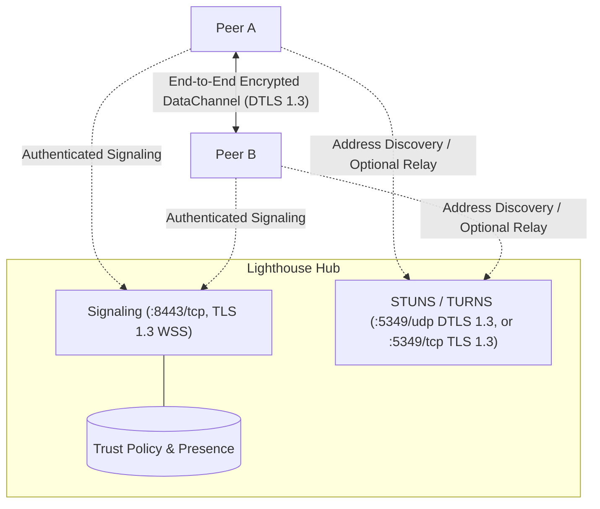

# Lighthouse

Lighthouse coordinates authenticated, end-to-end encrypted peer-to-peer WebRTC DataChannel connections through a single `linux/amd64` hub. It provides a single `lighthouse` binary for running the hub, connecting peers, and managing keys and policies.

## How It Works



1. **Identity & Trust**: Peers authenticate using persistent key pairs (`ed25519`, `ed448`, `nistp-256`, `nistp-384`, `nistp-521`, or `rsa`) verified against local pinned keys or offline-authority-signed membership records and ACL rules.
2. **Signaling**: Peers register with the hub over TLS 1.3 WebSockets and exchange signed session offers, answers, and ICE candidates.
3. **Transport**: Address discovery and optional relaying use encrypted DTLS 1.3 over UDP (`stuns:`/`turns:`) by default. Pass `--tcp-only` on hub and peers to disable UDP and use TLS 1.3 over TCP and ICE-TCP, or `--insecure` to opt in to plaintext `stun:`/`turn:`.
4. **Direct Data**: Once connected, peers exchange application data over end-to-end DTLS 1.3 encrypted WebRTC DataChannels directly (or via a configured TURN relay); the hub never decrypts peer traffic.

## Usage

### 1. Build or Pull

Build the binary locally:

```bash
make build
```

Or run the hub container via GHCR / Docker Compose (`linux/amd64`):

```bash
docker pull ghcr.io/<owner>/<repo>:latest
docker compose up -d --build
```

All `LIGHTHOUSE_*` environment variables and optional local `.env` entries are read at runtime.

### 2. Provision Keys and Policy

Generate an authority key and peer keys:

```bash
./bin/lighthouse admin keygen --out config/authority.key
./bin/lighthouse admin keygen --algo ed448 --out peer-a.key
./bin/lighthouse admin keygen --algo nistp-384 --out peer-b.key
```

Issue membership records for each peer:

```bash
./bin/lighthouse admin issue-membership \
  --authority config/authority.key \
  --peer-pub <PEER_A_PUBLIC_KEY> \
  --allow <PEER_B_ID> \
  --ttl 720h \
  --out peer-a-membership.json

./bin/lighthouse admin issue-membership \
  --authority config/authority.key \
  --peer-pub <PEER_B_PUBLIC_KEY> \
  --allow <PEER_A_ID> \
  --ttl 720h \
  --out peer-b-membership.json
```

Create `config/policy.json` for the hub and peers:

```json
{
  "v": 1,
  "trusted_authorities": [
    "<AUTHORITY_PUBLIC_KEY>"
  ],
  "acl_rules": [
    {
      "peer_a": "<PEER_A_ID>",
      "peer_b": "<PEER_B_ID>"
    }
  ]
}
```

### 3. Run the Hub

```bash
./bin/lighthouse hub \
  --policy config/policy.json \
  --tls-cert tls.crt \
  --tls-key tls.key \
  --hub-origin wss://hub.example.com
```

Send `SIGHUP` to reload updated policies and revocations without restarting.

| Flag | Environment Variable | Default | Description |
| --- | --- | --- | --- |
| `--https-addr` | `LIGHTHOUSE_HTTPS_ADDR` | `:8443` | TCP listen address for HTTPS/WSS signaling |
| `--stuns-addr` | `LIGHTHOUSE_STUNS_ADDR` | `:5349` | Encrypted STUNS/TURNS address (UDP default; TCP with `--tcp-only`) |
| `--stun-addr` | `LIGHTHOUSE_STUN_ADDR` | *(disabled)* | Plaintext STUN/TURN address (requires `--insecure`, default `:3478`) |
| `--tcp-only` | `LIGHTHOUSE_TCP_ONLY` | `false` | Disable UDP; use TLS 1.3 over TCP only |
| `--insecure` | `LIGHTHOUSE_INSECURE` | `false` | Allow plaintext `stun:`/`turn:` listener |
| `--turn-secret` | `LIGHTHOUSE_TURN_SECRET` | *(disabled)* | Shared secret for HMAC TURN REST credentials |
| `--turn-users` | `LIGHTHOUSE_TURN_USERS` | *(disabled)* | Static `user=pass[,user=pass]` TURN credentials |
| `--turn-realm` | `LIGHTHOUSE_TURN_REALM` | `lighthouse` | TURN authentication realm |
| `--turn-public-ip` | `LIGHTHOUSE_TURN_PUBLIC_IP` | *(auto)* | Static public IP advertised for TURN relay allocations |
| `--turn-tls-addr` | `LIGHTHOUSE_TURN_TLS_ADDR` | *(disabled)* | Optional TLS 1.3 / TCP TURNS fallback address |
| `--hub-origin` | `LIGHTHOUSE_HUB_ORIGIN` | `wss://localhost:8443` | Canonical WSS origin verified during registration |
| `--tls-cert` | `LIGHTHOUSE_TLS_CERT` | `/etc/lighthouse/tls.crt` | Server certificate PEM path |
| `--tls-key` | `LIGHTHOUSE_TLS_KEY` | `/etc/lighthouse/tls.key` | Server private key PEM path |
| `-p, --policy` | `LIGHTHOUSE_POLICY` | `/etc/lighthouse/policy.json` | Policy JSON path |
| `--sqlite` | `LIGHTHOUSE_SQLITE` | *(disabled)* | Optional SQLite state database path |
| `--presence-heartbeat` | — | `20s` | Peer heartbeat interval |
| `--presence-ttl` | — | `60s` | Presence lease lifetime |

### 4. Connect Peers

Start a listening peer:

```bash
./bin/lighthouse peer \
  --key peer-b.key \
  --membership peer-b-membership.json \
  --policy config/policy.json \
  --hub wss://hub.example.com/v1/signal \
  --stun stuns:hub.example.com:5349
```

Connect from a second peer:

```bash
./bin/lighthouse peer \
  --key peer-a.key \
  --membership peer-a-membership.json \
  --policy config/policy.json \
  --hub wss://hub.example.com/v1/signal \
  --stun stuns:hub.example.com:5349 \
  --connect <PEER_B_ID>
```

Optional transport modes:

```bash
# Authenticated TURNS relay (restrictive NATs)
./bin/lighthouse peer \
  --key peer-a.key --membership peer-a-membership.json --policy config/policy.json \
  --hub wss://hub.example.com/v1/signal \
  --turn turns:hub.example.com:5349 --turn-user <USER> --turn-pass <PASS> \
  --connect <PEER_B_ID>

# TCP-only mode (disables all UDP)
./bin/lighthouse hub --tcp-only --stuns-addr :5349 --policy config/policy.json --tls-cert tls.crt --tls-key tls.key
./bin/lighthouse peer --tcp-only --key peer-a.key --policy config/policy.json --stun stuns:hub.example.com:5349 --connect <PEER_B_ID>

# Opt-in plaintext STUN/TURN
./bin/lighthouse peer --insecure --key peer-a.key --policy config/policy.json --stun stun:hub.example.com:3478 --connect <PEER_B_ID>
```

Run `lighthouse --help` or `lighthouse help <subcommand>` for full CLI options.

## Documentation

- [Protocol, Wire Formats, and Architecture](docs/protocol-and-architecture.md)
- [Verification Procedures and Invariants](docs/verification.md)
