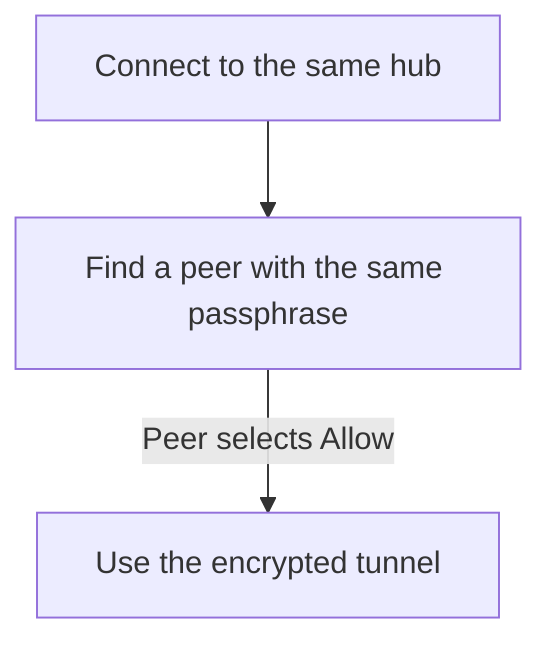

<p align="center">
  
</p>

<h1 align="center">Lighthouse</h1>

Lighthouse connects Linux computers over an end-to-end encrypted tunnel.  
Both computers use the same hub to find each other.  
The receiving user must approve each new connection.  

## How it works



## Connect with the desktop app

Use an existing hub or [run your own](#run-a-hub).  
[Build the desktop app](docs/installation-and-configuration.md#build-the-desktop-app) on each Linux computer.  
The app needs permission to create a virtual network interface.  

1. Start `./bin/lighthouse-ui` on both computers.  
2. Enter the hub address, such as `hub.example.com`, and select **Bind & Connect**.  
3. Enter the same passphrase on both computers and select **Join**.  
4. On the receiving computer, turn on **Broadcast** so the other computer can find it.  
5. On the sending computer, select **Connect** next to the peer.  
   To connect by ID, enter it under **Direct Peer ID** and select **Connect**.  
6. On the receiving computer, check the peer's identity and select **Allow**, **Deny**, or **Blacklist**.  

Use the peer's virtual IP from **Tunnels** to reach it.  
Manage blocked peers under **Blacklist**.  

## Run a hub

Start the published image on a Linux `amd64` host with Docker.  
For remote clients, [set the hub's hostname before starting it](docs/installation-and-configuration.md#trust-the-hub-certificate).  

```bash
docker run -d --name lighthouse --restart unless-stopped \
  -p 443:8443/tcp -p 5349:5349/udp \
  -v lighthouse_data:/etc/lighthouse \
  ghcr.io/parksnoopy/lighthouse-in-snoo:latest
```

The default hub uses a self-signed certificate.  
Follow [Trust the hub certificate](docs/installation-and-configuration.md#trust-the-hub-certificate) before connecting.  
For hosted deployments, see [Cloudtype and other HTTPS proxies](docs/installation-and-configuration.md#cloudtype-and-other-https-proxies).  

## Documentation

- [Installation and configuration](docs/installation-and-configuration.md)  
- [Protocol and architecture](docs/protocol-and-architecture.md)  
- [Developer verification](docs/verification.md)  
