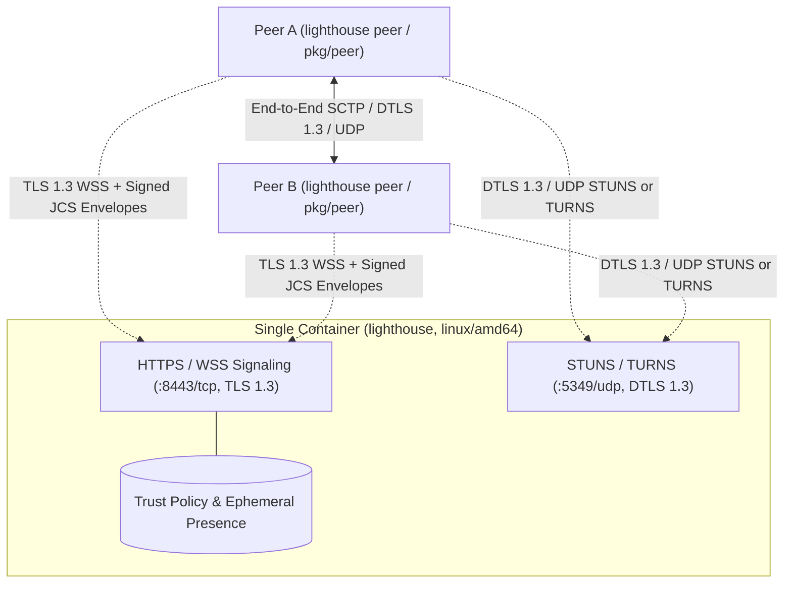

# Lighthouse (v0.1.0)

Lighthouse (`v0.1.0`, reported by `lighthouse --version`) coordinates authenticated, end-to-end encrypted WebRTC DataChannel connections through a single-container `linux/amd64` hub. Control-plane signaling runs over TLS 1.3 WSS (`:8443/tcp`), address discovery and optional relay run over **DTLS 1.3 / UDP** `stuns:`/`turns:` (`:5349/udp`) by default, and peer DataChannels run over SCTP protected end to end by DTLS 1.3 over UDP. For TCP-only networks, pass `--tcp-only` to disable UDP completely and run TLS 1.3 / TCP STUNS and ICE-TCP. Plaintext `stun:` and `turn:` require explicit opt-in via `--insecure`.

## Architecture



### Design Guarantees

- **Encrypted UDP-First ICE (`stuns:` / `turns:`)**: Both `lighthouse hub` and `lighthouse peer` enforce encrypted `stuns:` and `turns:` over **DTLS 1.3 / UDP** (`:5349/udp`) by default, prioritizing UDP over TCP. Plaintext `stun:` and `turn:` are rejected unless `--insecure` is explicitly passed.
- **Opt-In TCP-Only Mode (`--tcp-only`)**: When UDP is unavailable, `--tcp-only` (`LIGHTHOUSE_TCP_ONLY=true`) disables all UDP sockets on both hub and peers, serving STUNS/TURNS over TLS 1.3 / TCP (`:5349/tcp`) and negotiating end-to-end DTLS 1.3 DataChannels over ICE-TCP.
- **Independent Peer Authentication**: Peers authenticate each other using persistent identity keys (`ed25519`, `ed448`, `nistp-256`, `nistp-384`, `nistp-521`, `rsa`) verified against local pinned keys or offline-authority-signed membership records, independent of hub assertions.
- **End-to-End DTLS 1.3 Only**: Peer DataChannels enforce DTLS 1.3 (`0xFEFC`) with ephemeral ECDHE forward secrecy, AEAD record protection, replay window enforcement, and identity-authenticated SHA-256 certificate fingerprints. The hub never instantiates a WebRTC `PeerConnection` or terminates peer DTLS sessions.
- **Fail-Closed Policy Enforcement**: Direct UDP `host`/`srflx`/`prflx` candidates are used by default; `relay` candidates are rejected unless a validated `turns:` (or `--insecure` `turn:`) server is configured.

## Components

| Component | Path | Purpose |
| --- | --- | --- |
| `lighthouse` | `cmd/lighthouse` | Single binary providing `hub` (server), `peer` (client), and `admin` subcommands |
| `internal/hub` | `internal/hub` | TLS 1.3 HTTPS/WSS signaling (`:8443/tcp`) and DTLS 1.3 STUNS/TURNS coordination |
| `internal/stunserver` | `internal/stunserver` | DTLS 1.3 / UDP STUNS Binding responder (`:5349/udp`) with opt-in insecure UDP STUN |
| `internal/turnserver` | `internal/turnserver` | Authenticated DTLS 1.3 / UDP TURNS server (`:5349/udp`) with opt-in insecure UDP TURN |
| `pkg/identity` | `pkg/identity` | Multi-algorithm keys, `peer_id` derivation, offline authority memberships, ACLs |
| `pkg/protocol` | `pkg/protocol` | Strict JSON/RFC 8785 JCS control-plane schema and signed envelopes |
| `pkg/peer` | `pkg/peer` | Go SDK for DTLS 1.3 STUNS/TURNS ICE, WebRTC sessions, backpressure, and ICE restarts |

## Quick Start

### 1. Build Binary

Build directly with Go or `Makefile` (`cmd/lighthouse/version.go` is the single source of truth for the release version; all `LIGHTHOUSE_*` environment variables and optional local `.env` entries are read exclusively at runtime):

```bash
# Static linux/amd64 build
CGO_ENABLED=0 GOARCH=amd64 go build -o bin/lighthouse ./cmd/lighthouse

# Or build via Makefile
make build
```

### 2. Provision Offline Authority, Peer Keys, and Policy

Full-word options use `--` (e.g., `--policy`, `--help`); single-character short flags use `-` and may be combined (e.g., `-gik peer.key`). Use `-h` for compact help and `--help` or `help <subcommand>` for verbose help.

Generate an offline authority key and two peer keys (`--algo` supports `ed25519` [default], `ed448`, `nistp-256`, `nistp-384`, `nistp-521`, and `rsa` with `--bits 2048..8192`):

```bash
./bin/lighthouse admin keygen --out config/authority.key
./bin/lighthouse admin keygen --algo ed448 --out peer-a.key
./bin/lighthouse admin keygen --algo nistp-384 --out peer-b.key
```

Issue offline-authority-signed membership records for each peer:

```bash
./bin/lighthouse admin issue-membership \
  --authority config/authority.key \
  --peer-pub <PEER_A_PUBLIC_KEY> \
  --allow <PEER_B_ID> \
  --ttl 720h \
  --out peer-a-membership.json

./bin/lighthouse admin issue-membership \
  --authority config/authority.key \
  --peer-pub <PEER_B_PUBLIC_KEY> \
  --allow <PEER_A_ID> \
  --ttl 720h \
  --out peer-b-membership.json
```

Create `config/policy.json` (provisioned to the hub and each peer):

```json
{
  "v": 1,
  "trusted_authorities": [
    "<AUTHORITY_PUBLIC_KEY>"
  ],
  "acl_rules": [
    {
      "peer_a": "<PEER_A_ID>",
      "peer_b": "<PEER_B_ID>"
    }
  ]
}
```

### 3. Deploy the Hub with Docker / GHCR (`linux/amd64`)

Pull the `linux/amd64` hub container published to GitHub Container Registry by `.github/workflows/build.yml` (tagged to match `lighthouse --version`, e.g., `0.1.0` / `v0.1.0`), or build locally with Docker Compose:

```bash
# Pull published linux/amd64 hub image matching lighthouse --version (v0.1.0)
docker pull ghcr.io/<owner>/<repo>:v0.1.0

# Or build and run locally (loads optional .env at runtime via Compose env_file)
docker compose up -d --build
```

Or run the server directly with `./bin/lighthouse hub`. Reload updated ACL or revocation policies without restarting by sending `SIGHUP` to `lighthouse`.

### 4. Connect Two Peers

Start the responder peer (uses DTLS 1.3 / UDP `stuns:` by default):

```bash
./bin/lighthouse peer \
  --key peer-b.key \
  --membership peer-b-membership.json \
  --policy config/policy.json \
  --hub wss://hub.example.com/v1/signal \
  --stun stuns:hub.example.com:5349
```

Dial from the initiator peer:

```bash
./bin/lighthouse peer \
  --key peer-a.key \
  --membership peer-a-membership.json \
  --policy config/policy.json \
  --hub wss://hub.example.com/v1/signal \
  --stun stuns:hub.example.com:5349 \
  --connect <PEER_B_ID>
```

Use authenticated DTLS 1.3 / UDP `turns:` relay when peers sit behind restrictive NATs:

```bash
./bin/lighthouse peer \
  --key peer-a.key \
  --membership peer-a-membership.json \
  --policy config/policy.json \
  --hub wss://hub.example.com/v1/signal \
  --turn turns:hub.example.com:5349 \
  --turn-user <USER> \
  --turn-pass <PASS> \
  --connect <PEER_B_ID>
```

For sole-TCP environments where UDP is blocked, enable `--tcp-only` on both hub and peers (disables all UDP sockets):

```bash
./bin/lighthouse hub --tcp-only --stuns-addr :5349 --policy config/policy.json --tls-cert tls.crt --tls-key tls.key
./bin/lighthouse peer --tcp-only --key peer-a.key --policy config/policy.json --stun stuns:hub.example.com:5349 --connect <PEER_B_ID>
```

Plaintext `stun:` and `turn:` URIs require explicit `--insecure`:

```bash
./bin/lighthouse peer --insecure --key peer-a.key --policy config/policy.json --stun stun:hub.example.com:3478 --connect <PEER_B_ID>
```

## Hub Configuration

`lighthouse hub` accepts CLI options or environment variables:

| Flag | Environment Variable | Default | Description |
| --- | --- | --- | --- |
| `--https-addr` | `LIGHTHOUSE_HTTPS_ADDR` | `:8443` | TCP listen address for TLS 1.3 `/healthz` and WSS `/v1/signal` |
| `--stuns-addr` | `LIGHTHOUSE_STUNS_ADDR` | `:5349` | Listen address for encrypted STUNS/TURNS (DTLS 1.3/UDP default; TLS 1.3/TCP with `--tcp-only`) |
| `--stun-addr` | `LIGHTHOUSE_STUN_ADDR` | *(disabled)* | Plaintext STUN/TURN address; requires `--insecure` (`:3478` when `--insecure` is set) |
| `--tcp-only` | `LIGHTHOUSE_TCP_ONLY` | `false` | Disable UDP completely; serve STUNS/TURNS over TLS 1.3 / TCP only |
| `--insecure` | `LIGHTHOUSE_INSECURE` | `false` | Opt in to unencrypted `stun:`/`turn:` listener on `--stun-addr` |
| `--turn-secret` | `LIGHTHOUSE_TURN_SECRET` | *(disabled)* | Shared secret enabling authenticated DTLS 1.3 TURNS (HMAC TURN REST credentials) |
| `--turn-users` | `LIGHTHOUSE_TURN_USERS` | *(disabled)* | Static `user=pass[,user=pass]` credentials enabling authenticated DTLS 1.3 TURNS |
| `--turn-realm` | `LIGHTHOUSE_TURN_REALM` | `lighthouse` | RFC 8656 TURN authentication realm |
| `--turn-public-ip` | `LIGHTHOUSE_TURN_PUBLIC_IP` | *(auto)* | Static public IP advertised in TURN UDP relay allocations |
| `--turn-tls-addr` | `LIGHTHOUSE_TURN_TLS_ADDR` | *(disabled)* | Optional TLS 1.3 / TCP TURNS fallback listener (`?transport=tcp`) |
| `--hub-origin` | `LIGHTHOUSE_HUB_ORIGIN` | `wss://localhost:8443` | Canonical WSS origin bound into registration challenge proofs |
| `--tls-cert` | `LIGHTHOUSE_TLS_CERT` | `/etc/lighthouse/tls.crt` | Server certificate PEM (TLS 1.3 WSS + DTLS 1.3 STUNS/TURNS) |
| `--tls-key` | `LIGHTHOUSE_TLS_KEY` | `/etc/lighthouse/tls.key` | Server private key PEM |
| `-p, --policy` | `LIGHTHOUSE_POLICY` | `/etc/lighthouse/policy.json` | Trust, membership, ACL, and revocation policy file |
| `--sqlite` | `LIGHTHOUSE_SQLITE` | *(disabled)* | Optional SQLite database path for persistent administrative policy |
| `--presence-heartbeat` | — | `20s` | Advertised peer presence heartbeat interval |
| `--presence-ttl` | — | `60s` | Ephemeral presence lease expiration |

## Further Documentation

- [Protocol, Wire Formats, and Architecture](docs/protocol-and-architecture.md)
- [Verification Procedures and Invariants](docs/verification.md)
