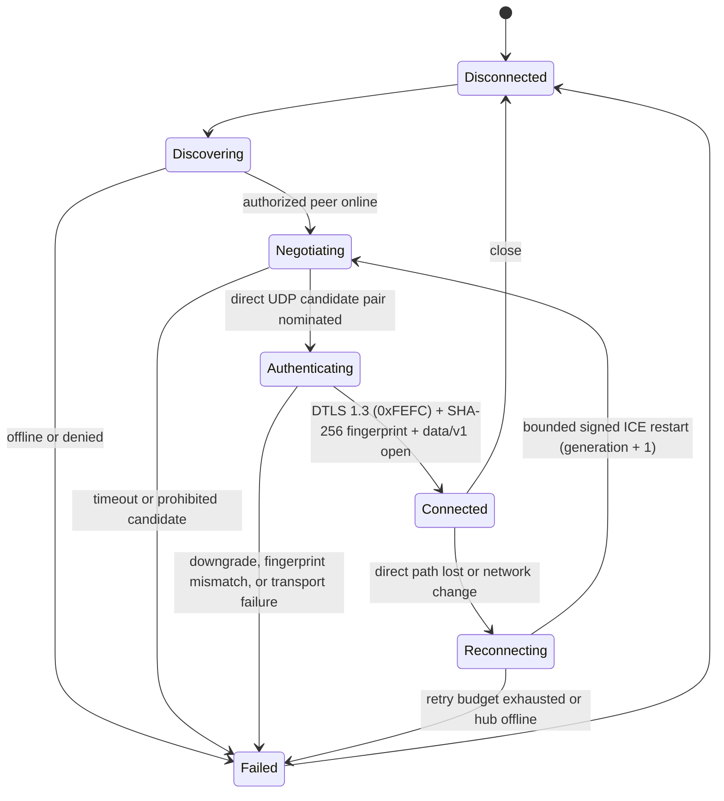

# Protocol, Wire Formats, and Architecture

## 1. Protocol Stack

```text
Application binary messages (<= 16 KiB per message)
WebRTC DataChannel / DCEP ("data/v1", optional "packet/v1")
SCTP (congestion control active, max-message-size = 16384)
DTLS 1.3 (RFC 9147, 0xFEFC, ECDHE + AEAD, replay window = 64, 0-RTT disabled)
ICE-selected direct UDP transport (host / srflx / prflx only; relay prohibited)
IPv4 / IPv6
```

Control-plane signaling runs out of band over `wss://<host>/v1/signal` using TLS 1.3 exclusively. Address discovery uses a UDP-only RFC 8489 STUN Binding responder on `:3478/udp`.

## 2. Cryptographic Identity and Trust

### 2.1 Peer Identifiers

- Identity key algorithm: Ed25519 (RFC 8032). Private keys are stored with `0600` file permissions; `pkg/identity.LoadKeyPair` rejects group/world-accessible key files.
- `peer_id`: unpadded `base64url` encoding (43 ASCII characters) of `SHA-256(raw_32_byte_ed25519_public_key)`.

### 2.2 Domain-Separated Signatures

All cryptographic signatures use RFC 8785 JSON Canonicalization Scheme (`internal/jcs`), rejecting invalid UTF-8, duplicate object keys at any nesting depth, trailing tokens, and out-of-schema fields prior to canonicalization.

| Purpose | Domain Prefix | Signed Payload |
| --- | --- | --- |
| Hub Registration | `"LIGHTHOUSE-REGISTER-V1\x00"` | `JCS({"challenge": "...", "hub_origin": "...", "peer_id": "..."})` |
| Authority Membership | `"LIGHTHOUSE-MEMBERSHIP-V1\x00"` | `JCS(MembershipRecord excluding "sig")` |
| P2P Signaling Envelope | `"LIGHTHOUSE-SIGNAL-V1\x00"` | `JCS(SignalEnvelope excluding "sig")` |

### 2.3 Independent Authorization and Revocation

`pkg/identity.TrustVerifier` enforces default-deny authorization on both the hub and every peer:

1. A peer identity must not appear in `revoked_peers`.
2. Identity authenticity requires either a locally pinned `{peer_id, public_key}` entry or a valid, non-expired `MembershipRecord` signed by an offline authority in `trusted_authorities`.
3. Pairwise communication requires explicit authorization in `acl_rules` (and must satisfy `allowed_peers` scopes if present in either peer's `MembershipRecord`).

## 3. Control-Plane Wire Protocol

### 3.1 Endpoints and Limits

- `GET /healthz`: returns HTTP `200` `{"status":"ok"}` with `Cache-Control: no-store` and no peer state.
- `WSS /v1/signal`: TLS 1.3 only (`MinVersion = MaxVersion = TLS 1.3`), UTF-8 JSON text frames only, max frame size `64 KiB` (`65536` bytes).
- Registration challenges are 32 random bytes (`base64url`), single-use per WSS connection, expiring after `60 s`.
- Presence leases default to `60 s` with `20 s` heartbeats.

### 3.2 Message Types

| Type | Direction | Description |
| --- | --- | --- |
| `challenge` | Hub → Peer | Single-use 32-byte registration challenge and canonical `hub_origin` |
| `register` | Peer → Hub | `peer_id`, `public_key`, optional `membership`, and `LIGHTHOUSE-REGISTER-V1` proof |
| `registered` | Hub → Peer | Registration confirmation, lease expiry, and heartbeat interval |
| `heartbeat` | Peer → Hub | Presence lease renewal |
| `lookup` | Peer → Hub | Authorized presence and identity query for `target` |
| `lookup_result` | Hub → Peer | `online` boolean plus `public_key` and `membership` for independent verification |
| `offer` | Peer → Peer | Signed envelope carrying `{"sdp": "<unmodified SDP offer>"}` |
| `answer` | Peer → Peer | Signed envelope carrying `{"sdp": "<unmodified SDP answer>"}` |
| `candidate` | Peer → Peer | Signed trickled ICE candidate (`candidate`, `sdpMid`, `sdpMLineIndex`, `usernameFragment`) |
| `end_of_candidates` | Peer → Peer | Signed generation gathering completion (`usernameFragment`) |
| `close` | Peer → Peer | Signed negotiation cancellation or closure (`reason`) |
| `error` | Hub → Peer | Machine-readable failure code (`code`, optional `detail`, optional `session_id`) |

### 3.3 Ordering, Buffering, and Replay Protection

- `session_id` is a random 128-bit identifier (`22`-character unpadded `base64url`).
- `seq` starts at `0` and increments monotonically per `(from, session_id, generation)`.
- Signaling TTL defaults to `60 s` with `30 s` maximum clock skew tolerance.
- The hub verifies sender session binding (`env.from == session.peer_id`), ACL authorization, signature validity, monotonic `seq`, and the `128`-candidate limit per `(sender, generation)` before forwarding the unmodified JSON frame to online recipients.
- Receiving peers independently verify identity, ACL, signature, expiry, session replay history, and generation freshness. Trickled candidates arriving prior to `SetRemoteDescription` are buffered in `seq` order (up to `128`) and installed only after the verified SDP is applied.
- If WSS disconnects before a negotiation reaches `Connected`, the peer abandons that negotiation so subsequent attempts use a fresh `session_id`. Already-`Connected` direct sessions continue across hub outages.

## 4. Direct Transport, State Machine, and DataChannels

### 4.1 Candidate Policy and Glare Resolution

- Allowed UDP candidate types: `host`, `srflx`, `prflx`.
- Prohibited: `relay` candidates, TCP candidates, `ice-lite`, audio/video media descriptions, `turn:`/`turns:`/`stuns:` URIs, and candidates targeting hub signaling or STUN endpoints.
- Concurrent offers for the same peer pair resolve deterministically: the offer from the lexicographically smaller `peer_id` wins.

### 4.2 Connection State Machine



### 4.3 DataChannels and Backpressure

| Label | Ordered | Reliability | Limit |
| --- | --- | --- | --- |
| `data/v1` | `true` | Reliable | `16 KiB` per message |
| `packet/v1` (optional) | `false` | `maxRetransmits = 0` | `16 KiB` per message |

The answerer closes any incoming DataChannel with an unrecognized label or mismatched reliability attributes. Outbound senders enforce a `1 MiB` per-peer queue cap combined with SCTP `BufferedAmount` low/high watermarks (`256 KiB` / `512 KiB`), suspending new payload transmission immediately whenever the direct path is unverified.

## 5. Pinned Reference Dependencies

| Module | Version | Role |
| --- | --- | --- |
| `github.com/pion/webrtc/v5` | `v5.0.0-rc.4` | Native Go WebRTC PeerConnection, ICE, SCTP, DCEP |
| `github.com/pion/dtls/v4` | `v4.0.1` | DTLS 1.3 (RFC 9147) handshake and AEAD record layer |
| `github.com/pion/ice/v5` | `v5.0.0-rc.9` | Full ICE agent and candidate parser |
| `github.com/pion/stun/v5` | `v5.0.0-rc.3` | RFC 8489 STUN wire codec |
| `github.com/pion/sdp/v3` | `v3.0.20` | SDP parsing and pre-installation policy inspection |
| `github.com/pion/transport/v5` | `v5.1.5` | Network abstraction and `vnet` virtual NAT/router testing |
| `github.com/coder/websocket` | `v1.8.15` | Bounded TLS 1.3 WebSocket client and server |
| `modernc.org/sqlite` | `v1.63.0` | Optional pure-Go SQLite administrative policy persistence |
